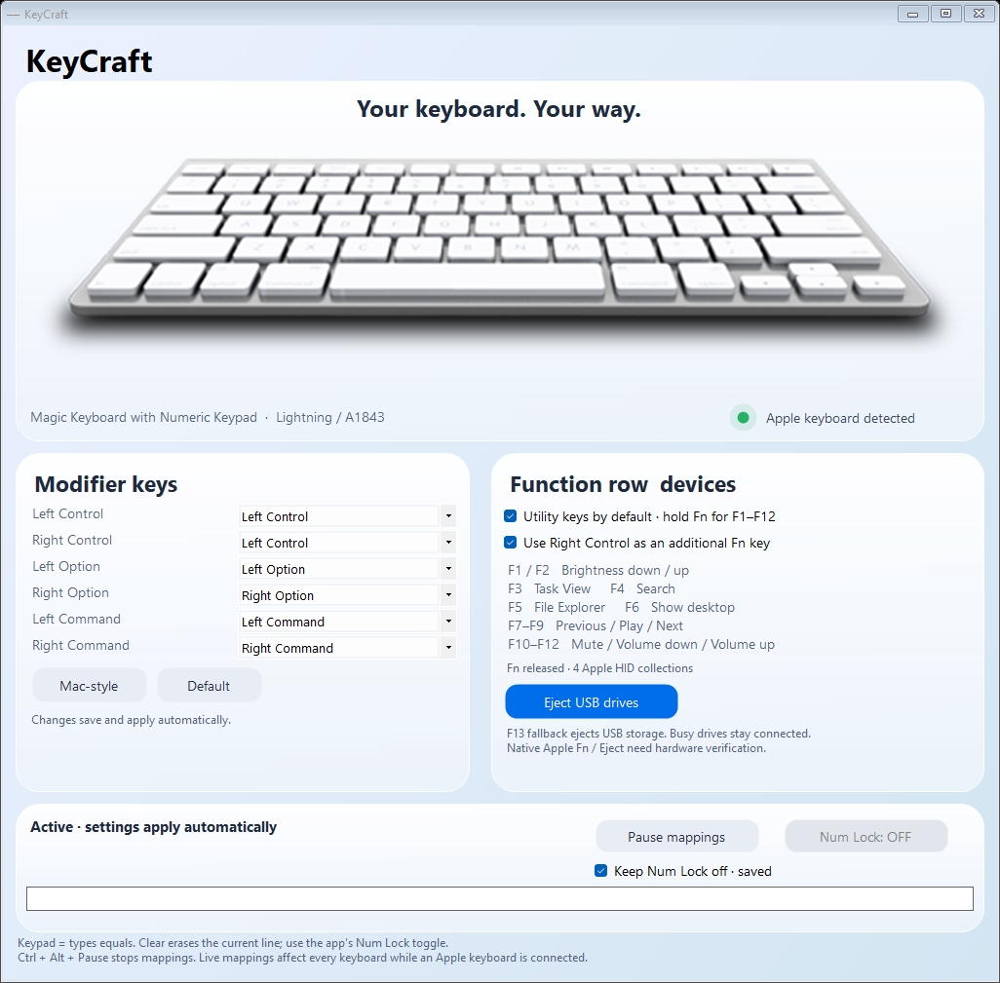

# KeyCraft

A native Windows utility for Apple keyboards, with configurable modifier keys, utility shortcuts, numeric keypad controls, and safe USB storage ejection.



## Run

Download the repository ZIP, extract it, and open `KeyCraft.exe`. Keep the `assets` folder beside the executable. Requires Windows x64 and .NET Framework 4.8.

KeyCraft activates when it detects an Apple keyboard. Settings save and apply immediately. Closing the window keeps it running in the system tray; use the tray menu to exit. **Ctrl + Alt + Pause** pauses mappings.

## Features

- Separate left/right Control, Option, and Command mappings, plus a Mac-style preset.
- Utility actions on F1–F12: display brightness, Task View, Search, File Explorer, Show desktop, media playback, and volume.
- Right Control as an optional Fn modifier to access standard F1–F12.
- Keypad equals support and a Clear action that erases the current line.
- An on-screen Num Lock toggle and a saved **Keep Num Lock off** setting.
- Safe USB storage removal through the app, tray menu, or F13. Busy and protected system disks are excluded from successful removal.
- An animated connection indicator and a compact interface that fits without scrolling. Maximizing centers the content instead of stretching it.
- Dedicated keyboard input thread and cached keyboard artwork for responsive input and rendering.

## Function row

| Keys | Action |
| --- | --- |
| F1 / F2 | Brightness down / up |
| F3 / F4 | Task View / Search |
| F5 / F6 | File Explorer / Show desktop |
| F7 / F8 / F9 | Previous / Play-pause / Next |
| F10 / F11 / F12 | Mute / Volume down / Volume up |
| F13 | Request safe USB storage removal |

## Current limitations

Apple keyboard detection controls activation; live mappings affect all keyboards while active. Hardware validation has focused on the Lightning Magic Keyboard with Numeric Keypad (A1843).

Native Apple Fn and Eject support is attempted through accessible HID reports but remains unverified. Right Control and F13 are the available fallbacks. Brightness depends on WMI or DDC/CI support in the display and connection. Battery reporting is not implemented.

Clear uses Home, Shift+End, and Backspace. Its behavior depends on the focused application; on an empty multiline line it can join the preceding line. Keypad 5 with Num Lock off is preserved. **Keep Num Lock off** is enforced while KeyCraft is running and active; it does not modify Windows startup policy.

Settings are stored in `%LOCALAPPDATA%\KeyCraft\profile.txt`.

## Build

```powershell
powershell -ExecutionPolicy Bypass -File .\build.ps1
```

The build uses the .NET Framework C# compiler included with Windows. All application source and required graphical assets are included.

KeyCraft is an independent project and is not affiliated with Apple or Microsoft.
